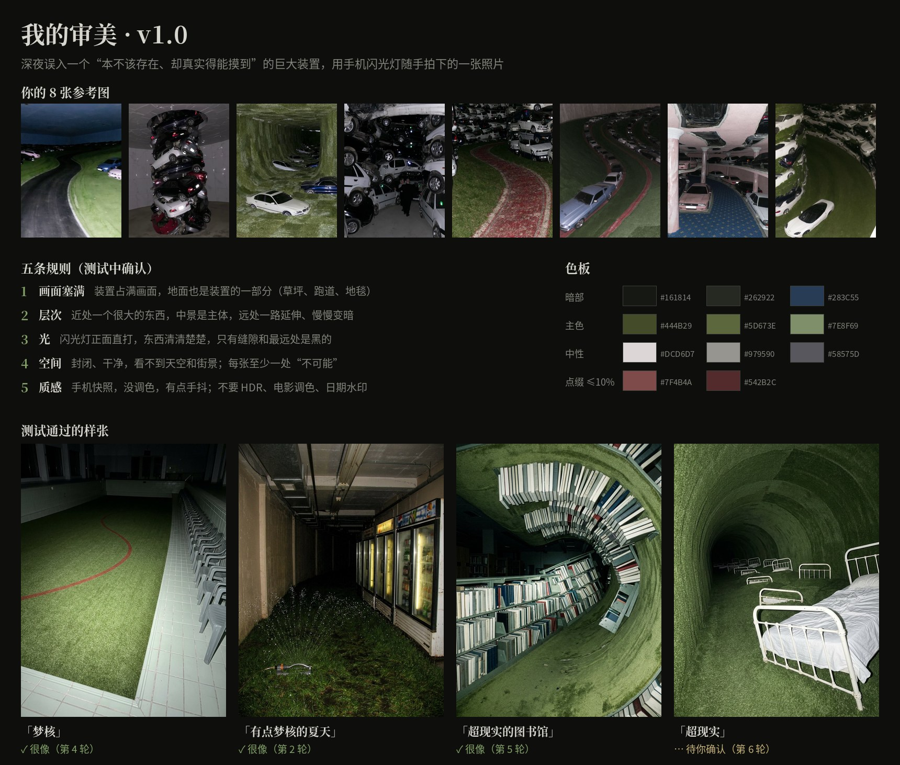

# 我的审美 · Aesthetic Translator

一个个人视觉审美 Skill：把「梦核」「超现实」「夏天」等宽泛的词，翻译成具体画面，并生成适用于 **Seedream、Nano Banana、GPT Image 和 Seedance** 的提示词。

## 仓库内容

```text
aesthetic-translator/
├── SKILL.md                                  # Skill 定义与完整审美规则
├── examples.md                               # 「梦核」与「超现实的图书馆」示例
└── assets/
    └── aesthetic-reference-board-v1.0.jpg     # 审美参考板与色板
```

## 安装

### Claude Code：个人 Skill

将整个 `aesthetic-translator` 目录复制到个人技能目录：

```bash
mkdir -p ~/.claude/skills
cp -R aesthetic-translator ~/.claude/skills/
```

安装后，技能入口应位于：

```text
~/.claude/skills/aesthetic-translator/SKILL.md
```

### Claude Code：项目 Skill

在目标项目根目录执行：

```bash
mkdir -p .claude/skills
cp -R /path/to/aesthetic-translator .claude/skills/
```

其他支持 `SKILL.md` 的工具，可将整个 `aesthetic-translator` 目录放入对应的技能目录。

## 使用示例

安装后，可以直接提出：

- `出图 梦核`
- `出视频 超现实的图书馆`
- `系列 夏天 ×3`
- `只要 GPT：有点梦核的夏天`
- `诊断 + 图片`

Skill 会按照内置审美规则补全空间、物件、光线、镜头和质感，并按工具分别输出提示词。完整输出样例见 [`examples.md`](aesthetic-translator/examples.md)。

## 审美参考板


